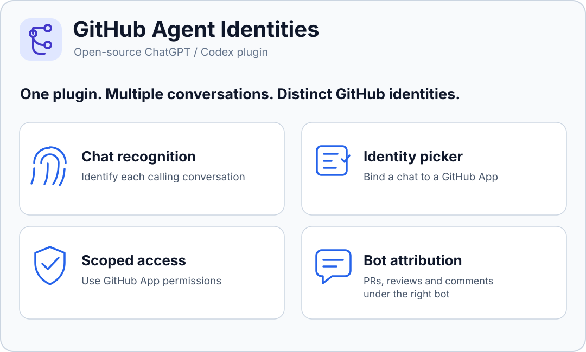

# GitHub Agent Identities

**One plugin. Multiple conversations. Distinct GitHub identities.**

Give separate ChatGPT or Codex conversations recognizable GitHub App identities when they collaborate on issues and pull requests—without standing up a separate plugin or MCP server for each agent.

> **Project status: tested foundation and private authentication code; live deployment pending.** The MCP server, D1 integration adapter/tests, GitHub App client, and Cloudflare Worker are implemented. The Worker now requires a verified Cloudflare Access Managed OAuth user and an operator allowlist before exposing identity tools. **Real Access/ChatGPT login, production deployment, GitHub App credential provisioning, and bot-attributed writes have not yet been verified.**

## How it will work

1. Deploy or connect to one MCP router that exposes identity and GitHub operations.
2. Configure your own GitHub Apps and restrict their installations to chosen repositories.
3. In each conversation, choose an available App identity (for example, Designer, QA, or Developer).
4. The router recognizes the calling conversation and selects its bound App for subsequent GitHub tool requests.
5. GitHub attributes API comments, reviews and PR actions to the corresponding App bot—not to the human who configured it.

A missing or unrecognized conversation binding will prompt you to choose an identity again. We intend to support a picker UI where the ChatGPT plugin interface permits it, with a simple role-selection fallback.

## Deployment and access

| Mode | Audience | Intended behavior |
| --- | --- | --- |
| **Self-hosted** | Anyone | Deploy your own MCP endpoint, bring your own GitHub Apps, and connect it to ChatGPT as a custom MCP server. No dependency on the maintainer's service. |
| **Private hosted instance** | Maintainer and invited friends/family | Same open-source server, but authenticated and access-restricted. **Not** a public free service. |
| **Public ChatGPT plugin** | Potential future release | A discoverable directory listing, subject to OpenAI's endpoint rules and publication review. |

**Self-hosting is a first-class goal**, not an afterthought. The core server and adapters exist, but the deployment walkthrough is **not yet runnable end-to-end**. See [Self-hosting and deployment architecture](docs/self-hosting.md), [private Cloudflare pilot](docs/cloudflare-pilot.md), [Access authentication setup](docs/cloudflare-access.md), and the [development roadmap](docs/roadmap.md).

### Public plugin publication: still on the roadmap

OpenAI's standard public MCP plugin submission currently requires a **stable, publicly accessible HTTPS endpoint**. Template endpoints that vary by customer are presently limited to trusted developers with an established relationship. This means we **cannot promise** that a publicly listed plugin will let every user type in an arbitrary self-hosted MCP URL. However, users can connect their own servers as **custom MCP connections** where their plan/workspace permits.

We'll revisit a dedicated project domain (rather than using the maintainer's personal domain), endpoint templates, reviewer requirements and a sustainable hosted/public distribution model later. Publishing is a goal—not a blocker for building and self-hosting now.

References: [OpenAI plugin submission](https://developers.openai.com/plugins/deploy/submission) · [MCP endpoint templates](https://developers.openai.com/plugins/deploy/app-review) · [Connecting custom MCP servers](https://help.openai.com/en/articles/12584461-connecting-custom-mcp-servers-in-chatgpt).

## Roadmap

### Implemented and tested

- [x] Demonstrate distinct ChatGPT conversations with independent role bindings.
- [x] Publish the TypeScript MCP server, real SDK HTTP protocol test, and automated regression suite.
- [x] Implement D1 binding adapter and SQL migrations (integration with a real D1 instance still pending).
- [x] Implement friendly identity discovery and binding tool fallback (graphical picker still pending).
- [x] Implement GitHub App registry, short-lived installation-token client, and PR read/comment modules (mock-tested; live operations still pending).
- [x] Add a Cloudflare Worker scaffold that **fails closed by default**.

### Next: private pilot

- [ ] [#15](https://github.com/keego/github-agent-identities/issues/15) — Real Worker/D1 integration, migrations and staging smoke tests.
- [ ] [#16](https://github.com/keego/github-agent-identities/issues/16) — Authenticated ChatGPT MCP access and isolated, verified tenants.
- [ ] [#17](https://github.com/keego/github-agent-identities/issues/17) — Securely wire GitHub App `5808833` installation `183125278`; prove a read-only App call.
- [ ] [#5](https://github.com/keego/github-agent-identities/issues/5) — Post a real PR comment as the selected GitHub App bot.
- [ ] [#18](https://github.com/keego/github-agent-identities/issues/18) — Tested self-hosting and operator runbook.
- [ ] [#7](https://github.com/keego/github-agent-identities/issues/7) — Validate a graphical identity picker and recovery UX.
- [ ] [#1](https://github.com/keego/github-agent-identities/issues/1) — Public Plugin Directory strategy and optional dedicated domain.

See [the implementation plan](docs/roadmap.md) for dependencies, release gates, and the operator setup boundary.

## Security principles

- GitHub App credentials stay in the operator's protected server-side secret store—never in chats or the open-source repository.
- Server authorization determines which GitHub Apps a user may bind; conversation metadata by itself is not a security credential.
- GitHub App installations should be limited to selected repositories, with only needed permissions.
- Public reachability of an HTTPS endpoint must **not** imply anonymous permission to perform GitHub writes.

## License

MIT. See [LICENSE](LICENSE).
